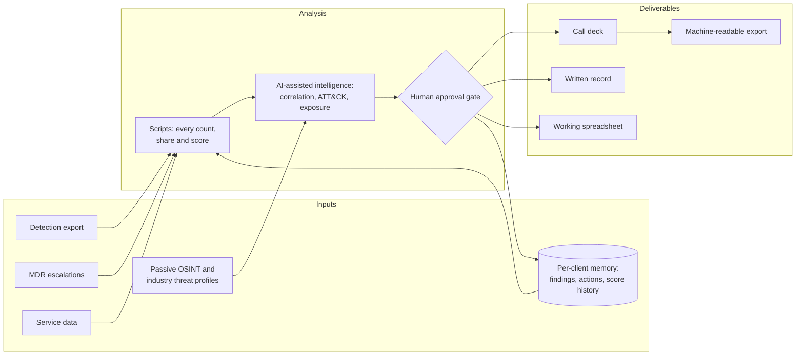

# SPAR | Security Posture Advisor Reporting

**Turning MDR telemetry into a recurring, evidence-grade security brief.**

SPAR | Security Posture Advisor Reporting is a client briefing practice I designed and run as a Staff Threat Advisor at one of "the big ones". Each cycle it combines a client's detection export, the record of what the MDR team escalated, and passive open-source intelligence. The output is a call deck, a written record, and a working spreadsheet, plus a running memory of every finding and recommendation so the next cycle picks up where the last one ended.

This repository documents the method: why it exists, how it works, the rules that keep it trustworthy, and how it evolved. **It contains no client data.** Metrics are aggregate totals that can't be traced to any organization.

> Every brief is held to one test: *could the client's CISO use this to justify a budget or policy decision without opening the security console?*

---

## At a glance

| | |
|---|---|
| Running since | May 2026 |
| Client environments | 61, across about ten industry clusters |
| Cadence briefs delivered | 107 decks, with 98 written records and 96 workbooks |
| Alerts analyzed | 1.85 million |
| MDR escalation cases reconciled | 909 |
| Priority findings tracked across cycles | 324, of which about one in three came back in a later cycle |
| Specification versions | 22, each archived with a dated reason for the change |

Full definitions and caveats: [`docs/07-metrics.md`](docs/07-metrics.md).

---

## The problem

MDR reporting is good at saying what happened in the alert queue. In my experience, Clients usually want answers to the questions that come after that:

- Which alerts cost my team the most time, and exactly what do we change to remove them?
- Which detections match campaigns aimed at my industry right now?
- What can an attacker learn about us without touching an endpoint?
- What is likely to come next, and what should we prepare?
- Is our detection and response configuration set up to catch it, and are our agents still supported?
- What did the service handle on our behalf?

## The four-part mission

1. **Reduce noise.** Specific suppression and policy changes from the client's own false-positive clusters, with last cycle's changes measured.
2. **Validate the real signal.** True positives checked against current primary-source threat reporting and mapped to MITRE ATT&CK.
3. **Show the danger from the outside in.** Passive OSINT exposure, turned into a client-side-first Action Plan with owners and timelines.
4. **Show what the service absorbed.** Alerts closed without needing the client and proactive work outside the queue, reported as counts the client can verify. No invented hours-saved or cost figures.

---

## How a cycle works

1. **Intake.** Confirm the client tier, load their memory file, and collect every operator-supplied input in one pass.
2. **Compute.** Scripts produce every number: alert breakdowns, noise clusters, recurrence matches, the posture score, agent-lifecycle buckets, and the escalated-versus-absorbed split.
3. **Assess.** A High Level model, under fixed rules, adjudicates ambiguous evidence, correlates findings with dated public reporting, runs the passive exposure pass, and assesses attack chain stage.
4. **Approve.** A human approves the storylines, suppression decisions, and anything ambiguous before any deliverable is built.
5. **Build and check.** All deliverables are built from the same approved content, visually checked, tone-checked, and run through an automated validator. Nothing ships on a failure.
6. **Remember.** Findings, actions, escalations, and score components are written back so the next cycle can flag recurrence and measure follow-through.

---

## What the brief covers

| Section | What it gives the client |
|---|---|
| Posture scorecard and trend | A directional 0–100 score with its components and change since last cycle |
| Configuration and health | Policy against the service baseline, escalation matrix, detection-rule coverage, agents health within six months |
| Executive summary | The noise lever, the real-incident headline, the exposure headline, and work delivered |
| Priority storylines | Evidence-backed findings with ATT&CK techniques, dated sources, and recurrence flags |
| Escalations and service metrics | What MDR raised, response times against objective by severity, and what the service absorbed |
| Outside-in exposure | Exploited-vulnerability overlap, leaked-credential counts, lookalike domains, exposed services |
| Noise reduction | False-positive clusters with exact console steps, and the measured effect of last cycle's tuning |
| Threat context | Current actors against the client's industry, and a watch list of exposures they match to that are under active exploitation |
| Horizon | A 90-day outlook and an attack chain-stage read, each paired with one preparation |
| Action Plan | Client-side actions first, each with an owner, timeline, expected outcome, and status |

Details: [`docs/02-methodology.md`](docs/02-methodology.md).

---

## Repository map

| Path | Contents |
|---|---|
| [`docs/01-value-writeup.md`](docs/01-value-writeup.md) | The full value write-up: intent, coverage, evolution, value |
| [`docs/02-methodology.md`](docs/02-methodology.md) | Cycle flow, deck structure, deliverables, workbook schema, recurrence rules |
| [`docs/03-posture-score.md`](docs/03-posture-score.md) | The scoring model, edge rules, and a worked example |
| [`docs/04-guardrails.md`](docs/04-guardrails.md) | Non-negotiable rules, the tone standard, and lessons from the failure-mode ledger |
| [`docs/05-evolution.md`](docs/05-evolution.md) | How the method changed from v1 to v6.1, and why |
| [`docs/06-ai-operating-model.md`](docs/06-ai-operating-model.md) | How AI is used, where it is not allowed, and how the practice runs without it |
| [`docs/07-metrics.md`](docs/07-metrics.md) | Aggregate metrics with definitions and caveats |
| [`templates/`](templates) | Fictional examples of the client memory file and an Action Plan row |
| [`CHANGELOG.md`](CHANGELOG.md) | Version history summary |

---

## What is deliberately not here

- **Client data of any kind.** No names, hostnames, indicators, case numbers, findings, or anything derived from a single environment.
- **Deliverables.** No decks, documents, or workbooks produced for clients.
- **Internal tooling and company material.** The scripts and the full internal specification are preserved. This repo describes what they do, not how they are implemented.

## Disclaimer

This is a personal portfolio project describing my own advisory method. It is not representative of any employer. Service scope for any offering is defined by its published Scope of Service.

---

**Jeremy San Nicolas** · Staff Threat Advisor
